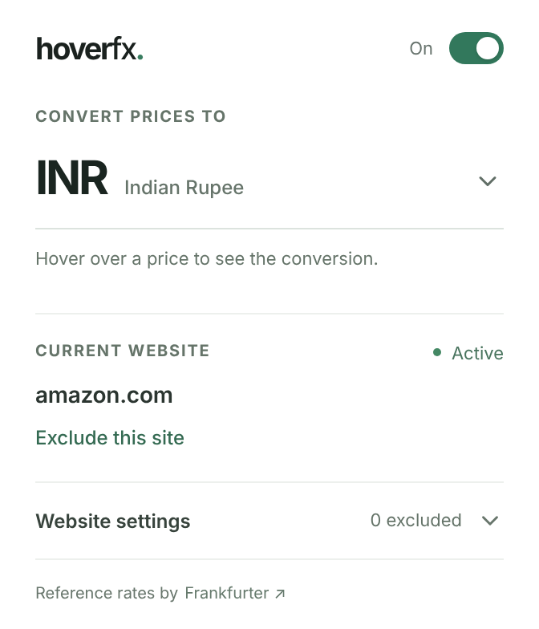
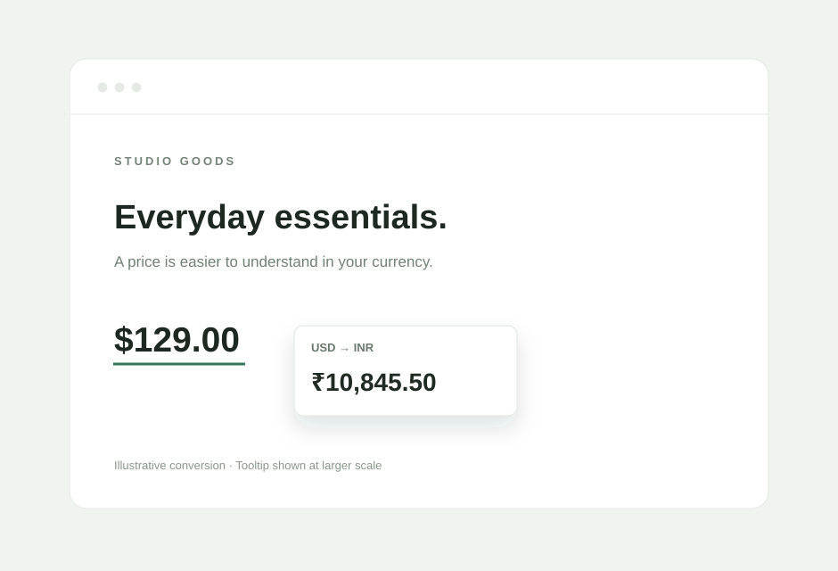

# HoverFX

**Hover over a price. See it in your currency.**

HoverFX is a lightweight extension for Chrome, Firefox, and Edge. Choose your preferred currency once, then hover over prices to see the conversion—without replacing prices or changing the website.

<p>
  
  
</p>

*HoverFX v0.2.1 · The example conversion above is illustrative, not a live quote.*

## Download

| Browser | Extension package |
| :--- | :--- |
|  **Chrome** | **[Download for Chrome](downloads/HoverFX-v0.2.1-Chrome.zip?raw=1)** |
|  **Firefox** | **[Download for Firefox](downloads/HoverFX-v0.2.1-Firefox.zip?raw=1)** |
|  **Edge** | **[Download for Edge](downloads/HoverFX-v0.2.1-Edge.zip?raw=1)** |

**These are manual-install developer builds, not one-click store installers.** Extract each ZIP before installing. The packages include `manifest.json` and all files required to load the extension.

## Install

- **Chrome:** Extract the Chrome ZIP → open `chrome://extensions` → enable **Developer mode** → **Load unpacked** → select the extracted folder containing `manifest.json`.
- **Edge:** Extract the Edge ZIP → open `edge://extensions` → enable **Developer mode** → **Load unpacked** → select the extracted folder containing `manifest.json`.
- **Firefox:** Extract the Firefox ZIP → open `about:debugging#/runtime/this-firefox` → **Load Temporary Add-on** → select `manifest.json`. Temporary add-ons are removed when Firefox restarts; permanent installation requires Mozilla signing.

## Features

- A small, two-line hover tooltip: `USD → INR` and the converted amount.
- Currency selection, on/off switch, and website exclusions.
- Source-currency overrides when a symbol (such as `$`) is ambiguous.
- Local rate caching to keep repeated conversions fast.
- Reference exchange rates from [Frankfurter](https://frankfurter.dev/), refreshed as needed.

## Privacy

There are no accounts, analytics, advertising trackers, or private API keys in HoverFX. Price detection runs locally in your browser. Rate requests only contain currency pairs, not your current page or the price you hovered over. Preferences and cached rates are stored in browser-local storage.

The extension needs access to websites so it can detect prices under your cursor; it also requests access to `api.frankfurter.dev` for rate updates. Rates are indicative and may differ from card or payment-provider rates.

## Source code

The editable TypeScript/WXT project is in [`extension/`](extension/). You do **not** need to build anything to use the downloads above.

To develop or rebuild (Node.js 22+):

```bash
cd extension
npm install
npm test
npm run typecheck
npm run build:all
```

Browser packages in `downloads/` are the prebuilt v0.2.1 packages. Rebuild and test each target browser before distributing an updated release.

---

Browser marks belong to their respective trademark holders. [Icon attribution and third-party notices](THIRD_PARTY_NOTICES.md).
